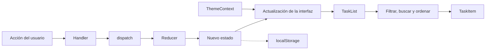
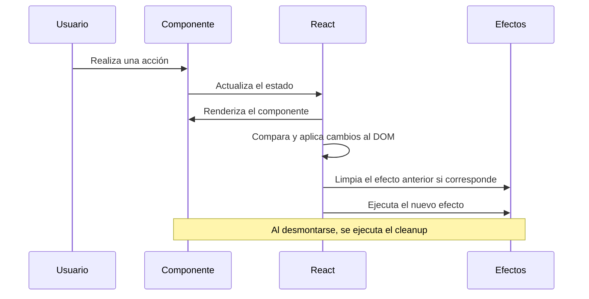

# Dashboard de Gestión de Tareas con React Hooks

**Asignatura:** Desarrollo de Aplicaciones Web (IS093A)  
**Guía práctica:** Semana 07 – Segunda parte  
**Alumno:** Deivid Willian Samaniego Quispe

## 1. Descripción del proyecto

En esta práctica desarrollé un gestor de tareas utilizando React 18 y Vite. El objetivo fue aplicar los hooks de React para organizar mejor el estado de la aplicación, controlar sus actualizaciones y mejorar el rendimiento de los componentes.

La aplicación permite agregar tareas, marcarlas como completadas, eliminarlas y utilizar filtros y un buscador para encontrar tareas específicas. También incorpora un tema claro y oscuro, un temporizador de sesión y almacenamiento local para conservar los datos aunque se recargue la página.

Durante el desarrollo utilicé diferentes hooks según las necesidades de cada componente. De esta manera, pude practicar tanto el manejo del estado como la optimización de renderizados y la limpieza de los efectos.

## 2. Cómo ejecutar el proyecto

Para ejecutar la aplicación, primero se deben instalar las dependencias y después iniciar el servidor de desarrollo.

```bash
npm install
npm run dev
```

También utilicé los siguientes comandos para comprobar que el proyecto esté correctamente configurado:

```bash
npm run lint
npm run build
```

El comando `lint` permite revisar el código y detectar problemas según las reglas configuradas en ESLint. Por su parte, `build` comprueba que la aplicación pueda compilarse para su distribución.

## 3. Organización de los archivos

Organicé el proyecto en carpetas para que cada componente y hook tenga una función específica. Esto facilita la lectura del código y permite realizar cambios sin tener que concentrar toda la lógica en un solo archivo.

```text
src/
├── App.jsx
├── contexts/
│   └── ThemeContext.jsx
├── hooks/
│   ├── useTasksReducer.js
│   ├── useLocalStorage.js
│   └── useDebounce.js
├── components/
│   ├── TaskForm.jsx
│   ├── Controls.jsx
│   ├── TaskList.jsx
│   ├── TaskItem.jsx
│   └── SessionTimer.jsx
└── utils/
    └── storage.js
```

- **App.jsx:** coordina la pantalla principal y el manejo de las tareas.
- **ThemeContext.jsx:** permite compartir el tema visual entre los componentes.
- **useTasksReducer.js:** concentra las acciones que modifican las tareas y sus filtros.
- **useLocalStorage.js:** facilita guardar y recuperar información del almacenamiento local.
- **useDebounce.js:** espera un breve tiempo después de escribir antes de actualizar la búsqueda.
- **TaskForm.jsx:** contiene el formulario para registrar nuevas tareas.
- **Controls.jsx:** permite cambiar los filtros y el orden de las tareas.
- **TaskList.jsx:** muestra las tareas que cumplen con los criterios seleccionados.
- **TaskItem.jsx:** representa cada tarea individual.
- **SessionTimer.jsx:** controla el temporizador de sesión.
- **storage.js:** contiene funciones auxiliares para trabajar con el almacenamiento local.

## 4. Cómo funciona el estado de la aplicación

El funcionamiento comienza cuando el usuario realiza una acción, como agregar una tarea, cambiar un filtro o marcar una actividad como completada. En esos casos, el componente correspondiente ejecuta una función que actualiza el estado mediante `dispatch` o `setState`, según el tipo de información que se esté modificando.

El reducer recibe la acción y genera un nuevo estado sin modificar directamente el anterior. Después, React actualiza los componentes que necesitan reflejar los cambios. Para evitar trabajo innecesario, la lista procesada puede aprovechar `useMemo` y los componentes que reciben propiedades estables pueden utilizar `React.memo`.

Por otro lado, el tema visual se comparte mediante `useContext`, mientras que los efectos se encargan de sincronizar determinados cambios con el almacenamiento local, el documento HTML y los temporizadores.

### Diagrama de flujo del estado



## 5. Ciclo de renderizado de React

Durante el desarrollo también revisé cómo React procesa los cambios en la interfaz. Cuando cambia un estado o una propiedad relevante, React vuelve a ejecutar los componentes correspondientes, compara el resultado con el anterior y aplica al DOM los cambios necesarios.

Después del commit, los efectos se ejecutan cuando corresponde. Si cambian sus dependencias, React realiza primero la limpieza del efecto anterior y después ejecuta el nuevo efecto. Cuando un componente se desmonta, también se ejecuta la función de limpieza que haya definido.

Este comportamiento es importante porque permite controlar recursos como temporizadores y evitar que sigan activos cuando ya no se necesitan.

### Diagrama del ciclo de renderizado



## 6. Por qué utilicé cada hook

En lugar de utilizar `useState` para manejar toda la aplicación, elegí cada hook según el problema que necesitaba resolver.

| Hook | Cómo lo utilicé |
|---|---|
| `useReducer` | Organicé las acciones de las tareas en un solo lugar. Esto facilita entender cómo cambia el estado y mantener una lógica ordenada. |
| `useState` | Lo utilicé para estados sencillos de la interfaz, como el contenido del buscador y la visibilidad del temporizador. |
| `useContext` | Me permitió compartir el tema claro u oscuro sin tener que pasar esa información manualmente por todos los componentes. |
| `useEffect` | Lo utilicé para sincronizar información con sistemas externos y controlar el ciclo de vida de los temporizadores y otros efectos. |
| `useMemo` | Lo apliqué al procesamiento de la lista para evitar repetir el filtrado, la búsqueda y el ordenamiento cuando sus entradas no cambian. |
| `useCallback` | Lo utilicé para conservar la identidad de funciones que se pasan a componentes optimizados, siempre que sus dependencias no cambien. |
| `useRef` | Me permitió acceder al campo del formulario para enfocarlo automáticamente sin provocar un renderizado adicional al modificar la referencia. |
| `useLocalStorage` | Creé este hook personalizado para reutilizar la lógica relacionada con guardar y recuperar información del navegador. |
| `useDebounce` | Lo utilicé para esperar 300 milisegundos después de la última tecla antes de actualizar la búsqueda. |

Elegí `useReducer` para las tareas porque existen varias acciones que modifican el mismo conjunto de datos. En cambio, para estados pequeños y sencillos, `useState` resulta suficiente y evita añadir complejidad innecesaria.

## 7. Decisiones para evitar optimizaciones innecesarias

Durante la práctica procuré no utilizar todos los hooks de optimización en cualquier situación. Mi objetivo fue emplearlos cuando realmente aportaran una ventaja.

Por ejemplo, no memoricé el contador de tareas completadas porque es un cálculo sencillo. También dejé el envío del formulario sin `useCallback`, ya que su función se utiliza directamente en un elemento del DOM y no necesitaba estabilizarse para un componente memoizado.

En cambio, sí utilicé `React.memo` en componentes como `Controls` y `TaskItem`, junto con `useCallback` para mantener estables las funciones que reciben. De esta manera, busqué reducir renderizados innecesarios sin hacer que el código fuera más difícil de entender.

## 8. Validaciones realizadas

### 8.1. Revisión del código con ESLint

Ejecuté `npm run lint` para revisar el código y comprobar que cumpliera las reglas configuradas. Presté especial atención a `react-hooks/exhaustive-deps`, que ayuda a detectar dependencias faltantes en los hooks.

Una dependencia incorrecta o incompleta puede provocar que un efecto utilice valores antiguos. Por eso, revisé las dependencias de los efectos y corregí las advertencias que aparecieron durante el desarrollo.

### 8.2. Comprobación del rendimiento con React DevTools Profiler

Utilicé React DevTools Profiler para observar qué componentes se renderizan al escribir en el buscador y al marcar una tarea como completada. Después comparé el comportamiento con `memo` y sin él para identificar si los demás elementos de la lista volvían a renderizarse innecesariamente.

Esta prueba me ayudó a comprender que `memo` y `useCallback` pueden trabajar juntos para evitar actualizaciones que no son necesarias cuando las propiedades permanecen iguales. También aprendí que el resultado debe comprobarse con el Profiler, en lugar de asumir que cualquier optimización mejora el rendimiento.

### 8.3. Comprobación de la limpieza de `useEffect`

Finalmente, probé el temporizador ocultándolo y mostrándolo varias veces mientras observaba la consola del navegador. Comprobé que, al dejar de utilizar el componente, se ejecutara la función de limpieza y se cancelara el intervalo mediante `clearInterval`.

También observé el comportamiento adicional de `React.StrictMode` durante el desarrollo, que permite detectar problemas en los efectos. Esta prueba me ayudó a entender por qué es importante limpiar los recursos que se crean dentro de `useEffect`.

## 9. Conclusión

Con esta práctica aprendí a organizar mejor el estado de una aplicación React y a utilizar sus hooks de acuerdo con las necesidades de cada componente. El uso de `useReducer` me permitió centralizar las acciones de las tareas, mientras que `useContext` facilitó compartir el tema visual. Además, los hooks personalizados ayudaron a reutilizar la lógica de almacenamiento y búsqueda.

Las pruebas con ESLint, React DevTools Profiler y la consola del navegador me permitieron revisar el código, observar los renderizados y comprobar la limpieza de los efectos. En general, esta experiencia me ayudó a comprender que desarrollar una aplicación no consiste solamente en lograr que funcione, sino también en mantener un código organizado, fácil de modificar y eficiente.

